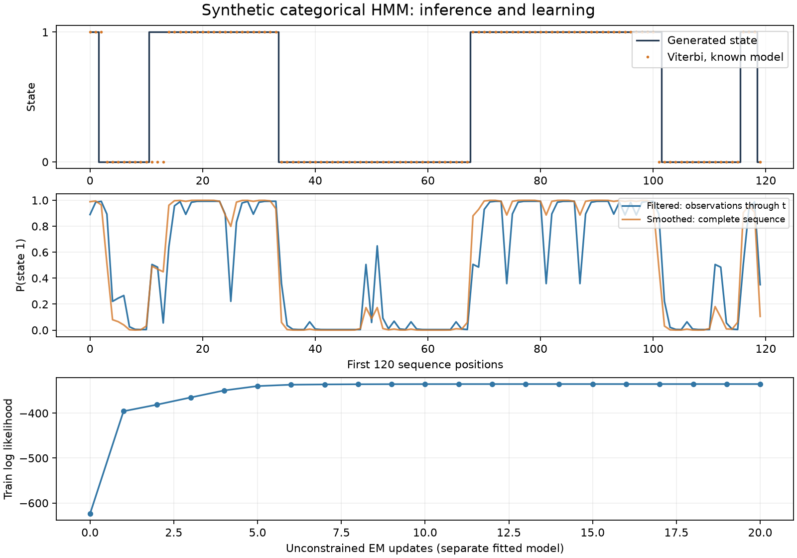

# HMM inference and intrusion-detection study

[](https://github.com/odebrino/hmm-intrusion-detection/actions/workflows/ci.yml)
[](LICENSE)

**Author: Rafael Ode Brino.** An individually authored Markov-model project combining an explicit Python HMM implementation, numerical checks, and a documented CICIDS2017 intrusion-detection study.

[Read the six-page report](report/Report.pdf) · [Study protocol and results](docs/research.md) · [Numerical implementation](docs/numerics.md)

The maintained package implements log-space forward/backward inference, posterior state probabilities, filtering, Baum–Welch EM, and Viterbi decoding. The study connects continuous features to discrete observations through training-fitted scaling and K-Means.



Generated-data example: filtered versus smoothed state probabilities, offline decoding under a known model, and a separate unconstrained EM fit. These are numerical demonstrations, not IDS performance results.

## Run without downloading a dataset

Use Python 3.12 or 3.14:

```bash
git clone https://github.com/odebrino/hmm-intrusion-detection.git
cd hmm-intrusion-detection
python3 -m venv .venv
source .venv/bin/activate
python -m pip install '.[dev,study]'
python -m pytest -q
python -m hmm_ids.demo --output-dir outputs/demo
```

The example records the seed, package versions, observation hash, likelihood history, and inference output in `outputs/demo/`. The core depends on NumPy/SciPy; Matplotlib produces the figure. The study extra supplies pandas and scikit-learn. No packaged HMM estimator is used.

## Small API

```python
import numpy as np
from hmm_ids import DiscreteHMM

model = DiscreteHMM(n_states=2, n_obs=3)
model.pi = np.array([0.6, 0.4])
model.A = np.array([[0.7, 0.3], [0.2, 0.8]])
model.B = np.array([[0.6, 0.3, 0.1], [0.1, 0.2, 0.7]])

alpha, log_likelihood = model.forward_log([0, 1, 2])
filtered = model.filter_probabilities([0, 1, 2])
path = model.viterbi([0, 1, 2])
history, final_score = model.baum_welch([0, 1, 2], n_iter=10)
```

`A[i, j]` is the transition from current state `i` to next state `j`. Filtering uses only each observed prefix; smoothing and Viterbi decoding use the full supplied sequence. Exact zero probabilities are preserved. [Conventions, edge cases, and tests](docs/numerics.md).

## What the report establishes

The academic study uses seven CICIDS2017 flow features, 64 K-Means symbols, and a three-state HMM. It evaluates an ordered holdout on a **constructed, label-organized sequence** of 6,000 flows. The supplied report records:

| Metric on its 900-flow test slice | HMM | Random Forest |
| --- | --- | --- |
| Exact-match accuracy | 96.56% | 97.89% |
| Attack-class F1 | 99.80% | 98.13% |

The HMM had higher attack-class F1 in that reported run while RF had higher overall accuracy. The intermediate “Suspicious” state has no matching reference labels. Full-sequence decoding and the constructed ordering do not establish an online detector, untouched original chronology, or performance on an independent deployment.

These figures come from the report and supplied diagnostics. They were not regenerated by the synthetic tests. The generic package has numerical corrections and a broader API; the report's IDS-specific implementation is retained separately in `study/`. [Full interpretation and source inventory](docs/research.md).

## Re-run the study

Obtain the Friday afternoon DDoS flow CSV from the [official CICIDS2017 dataset source](https://www.unb.ca/cic/datasets/ids-2017.html), then run:

```bash
python study/main.py --csv /path/to/Friday-WorkingHours-Afternoon-DDos.pcap_ISCX.csv \
  --output-dir outputs/study
```

The raw CSV is not included. New output depends on its version and the numerical environment. The CLI keeps generated figures out of the supplied report directory. [Protocol and reproduction limits](docs/research.md).

## Authorship and reuse

Rafael Ode Brino is the sole author of the project and report, as confirmed on 24 October 2026. This public edition corrects the report's earlier author line; its scientific content and figures are preserved.

The **software** is MIT licensed. The report and its supplied figures retain separate copyright; the external dataset has its own source and attribution requirements. See [NOTICE](NOTICE.md). Mathematical background: Rabiner's 1989 HMM tutorial, cited in the report, and the [hmmlearn tutorial](https://hmmlearn.readthedocs.io/en/stable/tutorial.html).
